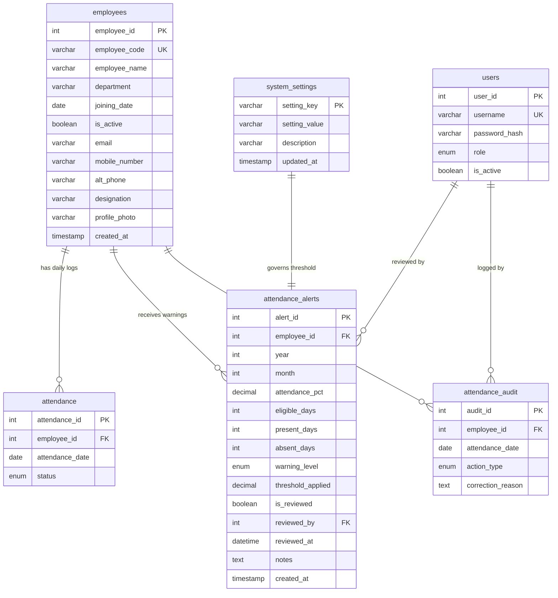

# AttendIQ: Advanced Attendance Intelligence, Smart Alerts & Reporting Documentation

## 1. Executive Summary & Architecture Overview

**AttendIQ** has been upgraded from a baseline attendance tracking script into an enterprise-grade **Employee Attendance Intelligence, Smart Warning & Compliance Management Platform**.

### Core Platform Upgrades Delivered
1. **Module 1 — Complete Employee Profile & Contact Management**: High-fidelity employee directory and profiles supporting official email addresses, primary mobile numbers, alternative emergency contact numbers, formal job designations, and profile avatars, reinforced by regex validation and multi-criteria search.
2. **Module 2 — Publication-Grade Individual PDF & Excel Reports**: Built with **ReportLab** and **XlsxWriter**, generating individual monthly and multi-period attendance statements featuring two-pass running pagination ("Page X of Y"), KPI matrices, behavioral pattern diagnostics, and formatted daily tables.
3. **Module 3 — Department-Wise PDF & Excel Audit Reports**: Departmental attendance audit packages aggregating departmental metrics, highlighting employees under the 75% critical threshold, and providing cross-department benchmarks.
4. **Module 4 — Smart Attendance Warning System (< 75%)**: Automated risk tiering classifying attendance into **CRITICAL** (< 75%), **ATTENTION** (75%–85%), and **NORMAL** (≥ 85%). Includes an admin-configurable threshold saved in `system_settings`, an automated idempotent warning synchronization engine that prevents duplicates via MySQL unique constraints, and an HR review tracking workflow.
5. **Module 5 — Advanced Attendance Diagnostics & Monthly Calendar Heatmaps**: Statistical analysis of consecutive absence streaks (with start and end dates), day-of-the-week absence clustering (e.g., Monday/Friday trends), multi-month trajectory insights, and an interactive 7-column monthly calendar heatmap matrix with 1-click record correction links.
6. **Module 6 — In-Website Notification System & Review Workflow**: Top-bar notification bell with real-time pending alert badge counters, sidebar status pills, HR sign-off forms, and an enterprise SMTP email specification with graceful simulated fallback.
7. **Module 7 — Executive Admin Dashboard Upgrade**: Executive KPI cards, dedicated attendance warning focus widget, department health breakdown table, and 1-click quick PDF & Excel export shortcuts.

### Invariant Business & Calculation Rules Preserved
- **Attendance Percentage Formula**:
  $$\text{Attendance Rate (\%)} = \frac{\text{Present}}{\text{Present} + \text{Absent} + \text{Leave}} \times 100$$
- **Absenteeism Percentage Formula**:
  $$\text{Absenteeism Rate (\%)} = \frac{\text{Absent}}{\text{Present} + \text{Absent} + \text{Leave}} \times 100$$
- **Eligible Days Formula**:
  $$\text{Eligible Days} = \text{Present} + \text{Absent} + \text{Leave}$$
  *(Holiday records are organization-wide non-working days and are strictly excluded from eligible denominator calculations).*
- **Department & Organization Aggregation Rule**: Always computed by summing individual counts across the unit first before calculating percentages. Percentages of percentages are strictly forbidden to avoid statistical skew.
- **Append-Only Auditing**: Attendance corrections require mandatory reasons and are permanently preserved in `attendance_audit`.
- **Zero Deletions**: Inactive employees are deactivated (`is_active = FALSE`), preserving full historical attendance integrity.

---

## 2. Database Schema Architecture

The database architecture has been enhanced with two new tables and new contact columns in `employees`. All migrations are safe, non-destructive, and idempotent.



### 2.1 Table: `attendance_alerts`
Stores monthly compliance alerts and supervisor review lifecycle records.

```sql
CREATE TABLE IF NOT EXISTS attendance_alerts (
    alert_id INT AUTO_INCREMENT PRIMARY KEY,
    employee_id INT NOT NULL,
    year INT NOT NULL,
    month INT NOT NULL,
    attendance_pct DECIMAL(5,2) NULL,
    eligible_days INT NOT NULL,
    present_days INT NOT NULL,
    absent_days INT NOT NULL,
    warning_level ENUM('NORMAL', 'ATTENTION', 'CRITICAL') NOT NULL,
    threshold_applied DECIMAL(5,2) NOT NULL,
    is_reviewed BOOLEAN NOT NULL DEFAULT FALSE,
    reviewed_by INT NULL,
    reviewed_at DATETIME NULL,
    notes TEXT NULL,
    created_at TIMESTAMP DEFAULT CURRENT_TIMESTAMP,
    UNIQUE KEY uq_emp_period (employee_id, year, month),
    FOREIGN KEY (employee_id) REFERENCES employees(employee_id) ON DELETE RESTRICT ON UPDATE RESTRICT,
    FOREIGN KEY (reviewed_by) REFERENCES users(user_id) ON DELETE SET NULL ON UPDATE CASCADE
);
```
- **Duplicate Prevention**: The compound key `UNIQUE KEY uq_emp_period (employee_id, year, month)` guarantees that repeatedly refreshing the dashboard or re-running synchronization will **never** generate duplicate alerts for the same employee in the same period.

### 2.2 Table: `system_settings`
Stores administrative configuration keys such as the dynamic critical attendance threshold.

```sql
CREATE TABLE IF NOT EXISTS system_settings (
    setting_key VARCHAR(100) PRIMARY KEY,
    setting_value VARCHAR(255) NOT NULL,
    description VARCHAR(255) NULL,
    updated_at TIMESTAMP DEFAULT CURRENT_TIMESTAMP ON UPDATE CURRENT_TIMESTAMP
);
```

---

## 3. Module Details & Capabilities

### Module 1: Complete Employee Profile Management
- **Contact Information**: Added `email`, `mobile_number`, `alt_phone`, `designation`, and `profile_photo`.
- **Validation**:
  - `validate_email(email)`: RFC 5322-compliant syntax validation.
  - `validate_phone(phone)`: International and national standard format validation (10 to 15 digits with optional `+` prefix).
- **Search & Filter**:
  - Multi-criteria lookup across employee full name, alphanumeric code (e.g. `E001`), database ID, department, designation, and email address.
  - Status filtering (`Active Only`, `Inactive Only`, or `All`).

### Module 2: Individual Employee PDF & Excel Reports
- **ReportLab PDF Generation** (`src/reports_pdf.py`):
  - In-memory stream generation (`io.BytesIO()`) without disk leaks.
  - Custom two-pass `NumberedCanvas` computing dynamic running headers and footers ("Page X of Y").
  - Executive KPI summary grid (Attendance %, Absenteeism %, Eligible Days, Present, Absent, Leave).
  - Behavioral analytics callout summarizing absence streaks, top absence weekdays, and trajectory.
  - Detailed daily log with alternating zebra striping and repeating headers across page splits.
- **XlsxWriter Excel Workbook** (`src/reports_excel.py`):
  - **Sheet 1: Summary & Analytics**: Executive KPI cards, employee profile metadata, and behavioral pattern diagnosis.
  - **Sheet 2: Daily Attendance Log**: Frozen header rows, auto-fitted columns, and conditional formatting for statuses.

### Module 3: Department-Wise PDF & Excel Reports
- **Aggregated Benchmarking** (`src/reports_pdf.py`, `src/reports_excel.py`):
  - Supports exporting single departments or all departments organization-wide.
  - Highlighted Critical Risk Callout identifying all personnel below the 75% threshold.
  - Cross-department comparison table ranking departments by attendance performance.

### Module 4: Smart Attendance Warning System (< 75%)
- **Multi-Tier Classification** (`src/alerts.py`):
  - `CRITICAL`: Attendance Rate < `threshold` (default 75.0%). Requires immediate intervention.
  - `ATTENTION`: Attendance Rate between `threshold` and 85.0%. Borderline attendance risk.
  - `NORMAL`: Attendance Rate ≥ 85.0%. Compliant attendance.
- **Idempotent Synchronization**: `sync_monthly_attendance_alerts(conn, year, month)` utilizes MySQL `ON DUPLICATE KEY UPDATE` to update statistics on re-sync while preserving existing reviewer sign-off history.
- **Review Lifecycle**: HR or Admin users sign off warnings with notes via `POST /alerts/<id>/review`.

### Module 5: Advanced Attendance Diagnostics & Heatmaps
- **Consecutive Absence Streaks**: Accurately tracks maximum consecutive unplanned absence streaks along with starting and ending dates.
- **Day-of-Week Absence Patterns**: Computes Monday through Friday absence distributions to diagnose specific patterns (such as weekend-adjacent absences).
- **Monthly Attendance Calendar Heatmap**: Generates a 7-column calendar matrix (Mon–Sun) mapping every day of the month with color badges:
  - Present: Emerald Green (`#dcfce7`)
  - Absent: Crimson Red (`#fee2e2`)
  - Leave: Amber Yellow (`#fef3c7`)
  - Holiday: Sky Blue (`#e0f2fe`)
  - Weekend: Muted Slate (`#f8fafc`)
  - Direct 1-click links to `/attendance/correct` for non-weekend recorded days.

### Module 6: In-Website Notification System
- **Real-Time Notification Bell**: Positioned in the application header with live unreviewed warning counter badges.
- **Sidebar Warning Counter**: Displays active pending warning counts next to the "Alerts" navigation item.
- **Automated Email Dispatcher** (`src/notifications.py`):
  - Generates HTML and plain text notices.
  - Dispatches via SMTP when configured (`SMTP_HOST`, `SMTP_PORT`, `SMTP_USER`, `SMTP_PASSWORD`).
  - Safely falls back to simulated logging mode when running in local development or test environments.

### Module 7: Executive Admin Dashboard Upgrade
- **Executive KPI Cards**: Real-time display of Active Headcount, Org Attendance Rate, Critical Risk (< 75%) Count, and Attention Needed Count.
- **Attendance Warning Focus Widget**: Prominently highlights flagged employees requiring supervisor sign-off directly on the main dashboard.
- **Department Health Breakdown Table**: Full departmental roster overview displaying headcounts, attendance percentages, and quick PDF export shortcuts.
- **Quick Action Bar**: One-click download shortcuts for monthly organization PDF and Excel reports.

---

## 4. Complete Route Catalog

| Method | Endpoint | Role | Description |
|---|---|---|---|
| `GET` | `/` | All | Executive dashboard with KPIs, alert widget, and department health table |
| `GET` | `/welcome` | Public | Public landing page (no DB access, static marketing) |
| `GET` | `/login` | Public | Authentication page with rate-limiting protection |
| `POST` | `/login` | Public | Authenticates credentials and starts session |
| `GET/POST`| `/logout` | Authenticated | Clears user session and redirects to login |
| `GET` | `/employees` | All | Staff directory with search and department/status filters |
| `GET` | `/employees/new` | HR / Admin | Form to add an employee with contact information |
| `POST` | `/employees/new` | HR / Admin | Validates and creates a new employee |
| `GET` | `/employees/<id>` | All | Employee analytics profile with heatmap & diagnostics |
| `GET` | `/employees/<code>/edit` | HR / Admin | Edit form for employee profile & contact details |
| `POST` | `/employees/<code>/edit` | HR / Admin | Updates employee profile and contact details |
| `GET` | `/employees/<id>/report/pdf` | All | Downloads individual employee PDF statement |
| `GET` | `/employees/<id>/report/excel` | All | Downloads individual employee Excel spreadsheet |
| `GET` | `/reports/department/pdf` | All | Downloads department or organization-wide PDF report |
| `GET` | `/reports/department/excel` | All | Downloads department or organization-wide Excel workbook |
| `GET` | `/alerts` | All | Smart Warning Center with filters, pagination, and review tools |
| `POST` | `/alerts/<id>/review` | HR / Admin | Signs off an attendance alert with review notes |
| `POST` | `/alerts/settings/threshold` | Admin | Updates critical attendance warning threshold |
| `POST` | `/alerts/sync` | HR / Admin | Triggers on-demand warning synchronization |
| `GET` | `/attendance` | All | Daily attendance records and filtered log table |
| `GET` | `/attendance/new` | HR / Admin | Form to record individual employee attendance |
| `POST` | `/attendance/new` | HR / Admin | Records individual attendance with weekend validation |
| `GET` | `/attendance/department` | HR / Admin | Batch recording grid for an entire department |
| `POST` | `/attendance/department` | HR / Admin | Atomically records batch attendance for a department |
| `GET` | `/attendance/correct` | HR / Admin | Attendance correction form |
| `POST` | `/attendance/correct` | HR / Admin | Modifies record with mandatory reason and audit entry |
| `GET` | `/holidays/new` | HR / Admin | Organization holiday creation form |
| `POST` | `/holidays/new` | HR / Admin | Records company-wide holiday for active employees |
| `GET` | `/audit` | All | Audit trail log displaying historical modifications |
| `GET` | `/users` | Admin | User account administration console |
| `POST` | `/users/new` | Admin | Creates a new HR or Admin user |
| `POST` | `/users/<id>/toggle` | Admin | Toggles user active/inactive status |
| `GET` | `/healthz` | Public | Healthcheck probe endpoint |

---

## 5. Verification & Testing Suite

The entire test suite covers all legacy features alongside every new module.

### Test Execution Summary
```
============================= test session starts =============================
platform win32 -- Python 3.14.6, pytest-9.1.1, pluggy-1.7.0
rootdir: C:\employee-attendance-analysis
collected 217 items

tests/test_analysis.py                      ........                        [ 3%]
tests/test_attendance.py                    ..........................      [15%]
tests/test_auth_and_upgrade.py              ............................... [30%]
tests/test_calculations.py                  ...................             [38%]
tests/test_dashboard_upgrade.py             .                               [39%]
tests/test_department_reports.py           ...                             [40%]
tests/test_employee_diagnostics.py         ...                             [42%]
tests/test_employees.py                     ................                [49%]
tests/test_migration.py                     ...                             [50%]
tests/test_notifications.py                 ...                             [52%]
tests/test_production_hardening.py          ..........                      [56%]
tests/test_profile_and_contacts.py          ......                          [59%]
tests/test_report_pages.py                  ............                    [65%]
tests/test_reporting_period_regression.py   .................               [72%]
tests/test_reports.py                       ..........                      [77%]
tests/test_reports_pdf_excel.py             ....                            [79%]
tests/test_smart_alerts.py                  ....                            [81%]
tests/test_web.py                           ............                    [86%]
tests/test_web_forms.py                     ............................... [100%]

======================= 217 passed in 83.23s (0:01:23) ========================
```

### Running the Test Suite
To run the automated test suite locally:
```powershell
# Run full regression suite
.\venv\Scripts\python.exe -m pytest -v

# Run new modules specifically
.\venv\Scripts\python.exe -m pytest tests/test_profile_and_contacts.py -v
.\venv\Scripts\python.exe -m pytest tests/test_reports_pdf_excel.py -v
.\venv\Scripts\python.exe -m pytest tests/test_department_reports.py -v
.\venv\Scripts\python.exe -m pytest tests/test_smart_alerts.py -v
.\venv\Scripts\python.exe -m pytest tests/test_employee_diagnostics.py -v
.\venv\Scripts\python.exe -m pytest tests/test_notifications.py -v
.\venv\Scripts\python.exe -m pytest tests/test_dashboard_upgrade.py -v
```

