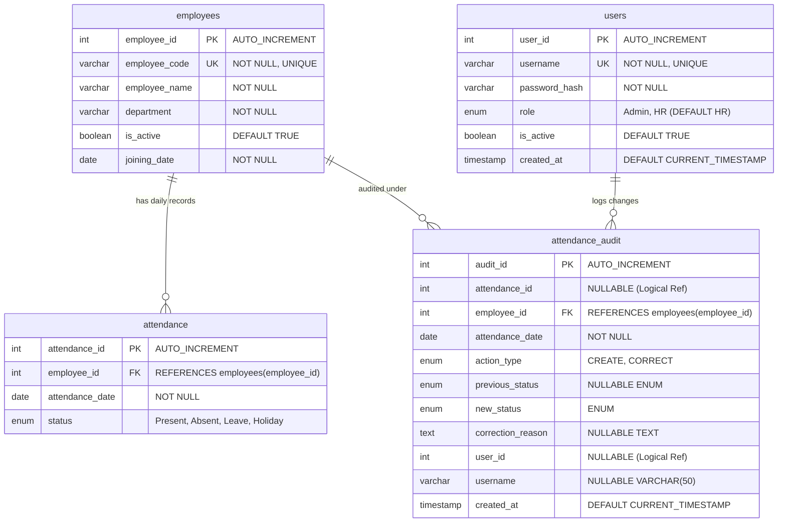
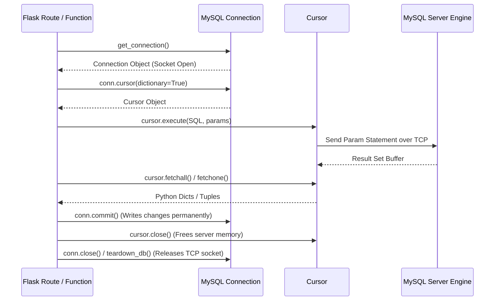
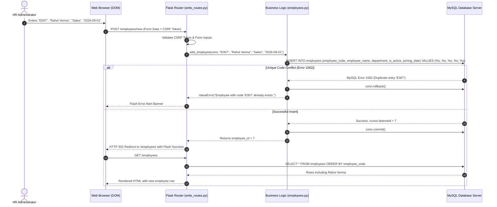
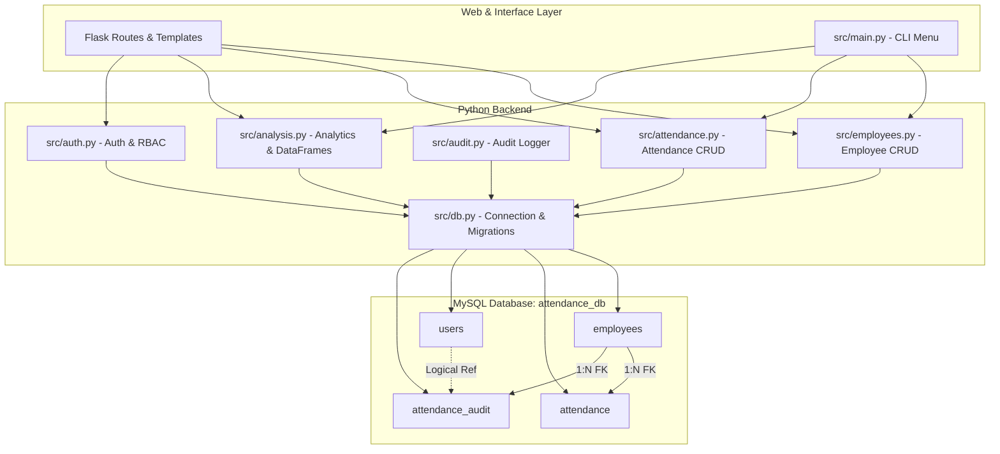

# Complete Database Documentation: AttendIQ Employee Attendance Analysis System

> **Document Type:** Comprehensive Technical & Educational Database Reference  
> **Target Audience:** From Absolute Beginners & Students to Technical Evaluators & Developers  
> **Project Name:** AttendIQ — Employee Attendance Analysis System  
> **Core Database Engine:** MySQL 8.0+  
> **Application Layer:** Python 3.14 / Flask / Pandas / Waitress  

---

## Table of Contents
1. [PART 1: Database Fundamentals from Absolute Zero](#part-1-database-fundamentals-from-absolute-zero)
2. [PART 2: Actual AttendIQ Database Architecture & Schema](#part-2-actual-attendiq-database-architecture--schema)
3. [PART 3: Complete SQL Creation Syntax & Line-by-Line Breakdown](#part-3-complete-sql-creation-syntax--line-by-line-breakdown)
4. [PART 4: How Python Connects to MySQL (Driver & Architecture)](#part-4-how-python-connects-to-mysql-driver--architecture)
5. [PART 5: How Data Travels Through AttendIQ (End-to-End Traces)](#part-5-how-data-travels-through-attendiq-end-to-end-traces)
6. [PART 6: Every Database Operation in the Project (Code & SQL Catalog)](#part-6-every-database-operation-in-the-project-code--sql-catalog)
7. [PART 7: SQL Queries, JOIN Mechanics & Aggregations](#part-7-sql-queries-join-mechanics--aggregations)
8. [PART 8: Database Security, Reliability & ACID Transactions](#part-8-database-security-reliability--acid-transactions)
9. [PART 9: Practical MySQL Workbench & CLI Handbook](#part-9-practical-mysql-workbench--cli-handbook)
10. [PART 10: Master College Viva Preparation (45 Questions & Answers)](#part-10-master-college-viva-preparation-45-questions--answers)
11. [PART 11: Final Rapid Revision & Evaluation Pitch](#part-11-final-rapid-revision--evaluation-pitch)

---

# PART 1: Database Fundamentals from Absolute Zero

### 1. What is a Database?
A **database** is an organized, secure, digital filing cabinet that stores data electronically on a computer system. Unlike a plain text file (`.txt`) or a spreadsheet (`.xlsx`) that can easily be corrupted, accidentally deleted, or locked when multiple people open it at the same time, a database allows thousands of people or programs to search, insert, and update information simultaneously without conflicts.

* **Example 1 (Physical Analogy):** Imagine an office register sitting on an HR desk. If two managers want to record attendance at 9:00 AM, one must wait for the other. If coffee spills on the register, all data is gone. A database is like an indestructible digital vault where both managers can write simultaneously from their computers without interfering.
* **Example 2 (Software Analogy):** If you save employee records in `employees.txt`, searching for employee "E005" requires reading every single line from top to bottom. A database uses structured indexing (like the alphabetical index at the back of a textbook) to jump directly to "E005" in less than a millisecond.

---

### 2. What is MySQL?
**MySQL** is a **Relational Database Management System (RDBMS)**. 
* **Relational** means it stores data in separate tables that link (relate) to one another using shared keys.
* **Management System** means it is an independent server software running in the background that controls data access, prevents unauthorized logins, enforces data integrity rules, and executes commands written in **SQL (Structured Query Language)**.

* **Example 1:** MySQL acts like a bank teller. You (the Python program) do not walk into the vault and grab dollar bills yourself. Instead, you hand a standardized withdrawal slip (a SQL command) to the teller (MySQL). The teller checks your credentials, ensures the rules are followed, and hands back the exact requested data.
* **Example 2:** In AttendIQ, when an HR manager submits attendance for 50 people on the website, Python does not write directly to a hard drive file. Python sends a SQL message to the MySQL server on port `3306`. MySQL validates that all 50 employees actually exist, writes the records, and reports success back to Python.

---

### 3. What is a Database Table?
A **table** is a structured, two-dimensional grid of data consisting of horizontal **rows** and vertical **columns**. Every table represents one specific real-world entity (such as an Employee, an Attendance Record, or a User Account).

* **Example 1 (`employees` table):** This table represents people employed by the company. It stores who they are: their code, their full name, their department, and their hire date.
* **Example 2 (`attendance` table):** This table represents daily check-in events. It does not store the employee's name or department; it only stores which employee showed up on which calendar date and what their status was.

---

### 4. What are Rows and Columns?
* **Column (Field / Attribute):** A vertical category that specifies a single type of information that every record must have.
* **Row (Record / Tuple):** A single horizontal entry that contains one complete item across all columns.

| Column: `employee_id` | Column: `employee_code` | Column: `employee_name` | Column: `department` |
| :--- | :--- | :--- | :--- |
| **Row 1:** `1` | `E001` | `Asha Rao` | `Engineering` |
| **Row 2:** `2` | `E002` | `Ravi Kumar` | `Engineering` |

* **Example 1 (Columns):** In AttendIQ, the `attendance` table has 4 columns: `attendance_id`, `employee_id`, `attendance_date`, and `status`. Every attendance record has these exact four characteristics.
* **Example 2 (Rows):** If Asha Rao is marked "Present" on September 1, 2026, that single check-in is one row in the `attendance` table. If 6 employees work for 22 days, the table will hold 132 rows.

---

### 5. What are Primary Keys and Foreign Keys?

#### Primary Key (PK)
A column (or set of columns) that guarantees **every single row in a table is uniquely identifiable**. A primary key cannot be `NULL` (empty), and no two rows can ever have the same primary key value.
* **Example 1:** Your National ID number or college student roll number. Two students might share the exact name "Rahul Sharma", but their roll numbers (`101` and `102`) make them distinct.
* **Example 2 (AttendIQ):** In the `employees` table, `employee_id` is an `INT AUTO_INCREMENT PRIMARY KEY`. When employee Asha Rao is inserted, MySQL automatically assigns her `employee_id = 1`.

#### Foreign Key (FK)
A column in one table that references and points to the Primary Key of another table. It creates a formal parent-child relationship between tables and prevents "orphan" records.
* **Example 1:** A library book checkout slip contains a student ID. If student `101` borrows a book, the slip stores `101`. The library software will reject the checkout if student `999` does not exist in the students register.
* **Example 2 (AttendIQ):** In the `attendance` table, the column `employee_id` is a Foreign Key that points back to `employees(employee_id)`. You can never mark attendance for `employee_id = 999` if that employee does not exist in the `employees` table.

---

### 6. What are Constraints?
**Constraints** are strict rules enforced directly by the database engine on table columns. If an incoming SQL query attempts to violate a constraint, MySQL rejects the command with an error, preventing corrupt or nonsensical data from ever reaching disk.

1. **`PRIMARY KEY`:** Enforces uniqueness and disallows `NULL`.
2. **`NOT NULL`:** Guarantees that a field cannot be left blank or empty.
3. **`UNIQUE`:** Guarantees that no two rows share the same value in that column (or combination of columns).
4. **`DEFAULT`:** Automatically fills in a predetermined value if the user does not provide one.
5. **`FOREIGN KEY ... REFERENCES ...`:** Guarantees referential integrity between two linked tables.
6. **`CHECK` / `ENUM`:** Restricts values to a specific predetermined list.

* **Example 1 (`NOT NULL`):** In AttendIQ, `employee_name` is `NOT NULL`. You cannot add an employee without a name.
* **Example 2 (`UNIQUE KEY uq_employee_date`):** In AttendIQ, the combination of `(employee_id, attendance_date)` is declared as a `UNIQUE KEY`. This means employee `1` cannot be marked "Present" twice on `2026-09-01`.

---

### 7. What are Data Types?
A **data type** tells MySQL what kind of data can be stored in a column, how much storage space to allocate, and how operations on that column behave (e.g., whether you can do math or search for text).

* **`INT`:** Whole numbers (e.g., `1, 2, 100`). Used for counters and IDs.
* **`VARCHAR(n)`:** Variable-length text up to `n` characters (e.g., `VARCHAR(50)` for names). It only consumes storage for the actual letters stored plus 1 byte for length.
* **`DATE`:** A calendar date formatted strictly as `YYYY-MM-DD` (e.g., `2026-09-01`). Allows calendar math (subtracting dates, checking weekdays).
* **`BOOLEAN`:** A true/false flag (in MySQL, stored internally as `TINYINT(1)` where `1 = TRUE` and `0 = FALSE`).
* **`ENUM('val1', 'val2', ...)`:** A string object with a value chosen from a permitted list of values. Prevents typos.
* **`TIMESTAMP`:** An absolute point in time (date and time) that defaults to the exact moment a record was created (`CURRENT_TIMESTAMP`).

* **Example 1:** If you store an employee's hire date as text (`"September First"`), MySQL cannot tell if it is a weekend or calculate how many days they have worked. By using `DATE`, MySQL can calculate `DATEDIFF('2026-09-30', joining_date)`.
* **Example 2:** In AttendIQ, the `status` column in `attendance` is `ENUM('Present', 'Absent', 'Leave', 'Holiday')`. If a user attempts to insert `"Sick"` or `"Here"`, MySQL instantly halts and throws an error.

---

### 8. What is a Relationship Between Tables?
A **relationship** defines how records in one table correspond to records in another table.

1. **One-to-Many (1:N):** One row in Table A can connect to multiple rows in Table B. But each row in Table B connects to only one row in Table A.
   * *AttendIQ Example:* One employee has many attendance rows over time. Employee `1` (Asha) has 22 attendance rows for September. But each attendance row belongs to exactly one employee.
2. **One-to-One (1:1):** One row in Table A connects to at most one row in Table B.
   * *Example:* An employee profile and their confidential government tax file.
3. **Many-to-Many (M:N):** Many rows in Table A connect to many rows in Table B. This requires an intermediary "bridge" or "junction" table.
   * *Example:* Students and Courses. One student enrolls in many courses; one course has many students.

---

### 9. What is CRUD?
**CRUD** represents the four fundamental operations performed on persistent data in any application:

| Operation | SQL Command | AttendIQ Feature |
| :--- | :--- | :--- |
| **C** - Create | `INSERT INTO` | Adding a new employee (`add_employee`) or recording daily attendance (`record_attendance`) |
| **R** - Read | `SELECT` | Viewing the dashboard KPI cards, listing employees, or generating monthly reports |
| **U** - Update | `UPDATE` | Correcting an attendance status from Absent to Present, or editing an employee's department |
| **D** - Delete | `DELETE` / Soft-Delete | In AttendIQ, records are never physically destroyed; employees are deactivated (`UPDATE employees SET is_active = FALSE`), and audit logs are permanent |

* **Example 1:** When HR fills out the "Add Employee" form and clicks Submit, the application executes a **Create** (`INSERT INTO employees`).
* **Example 2:** When the HR manager visits `/attendance`, the application executes a **Read** (`SELECT ... FROM attendance JOIN employees`).

---

### 10. Why Does AttendIQ Need a Database?
Why not just store attendance in an Excel sheet or a CSV file?
1. **Multi-User Concurrency:** Multiple HR officers can log in, view reports, and record attendance at the exact same moment without locking or corrupting files.
2. **Strict Data Integrity:** MySQL guarantees that duplicate attendance for the same employee on the same date is physically impossible via database-level `UNIQUE` constraints.
3. **Relational Security & Referencing:** Foreign keys prevent deleting an employee who already has attendance records on file.
4. **Audit Trail Accountability:** The database ensures that every status change is permanently captured in the `attendance_audit` table.
5. **ACID Transactions:** When recording attendance for an entire department of 20 people, MySQL guarantees that either all 20 records are saved or none are saved if a single conflict arises.

---

# PART 2: Actual AttendIQ Database Architecture & Schema

### 1. Database Identification
* **Production Database Name:** `attendance_db` (Defined in `.env` as `DB_NAME=attendance_db`)
* **Test Database Name:** `attendance_db_test` (Defined in `.env` as `DB_TEST_NAME=attendance_db_test`)
* *Architectural Safety Rule:* Unit tests strictly enforce that test executions will crash immediately if the connected database does not end with `_test`.

---

### 2. Entity-Relationship (ER) Diagram
The AttendIQ database is composed of **4 relational tables**:



---

### 3. Detailed Table Specifications

#### Table 1: `employees`
* **Purpose:** Stores the core master directory of all workers in the company.

| Column Name | Data Type | Nullable | Default | Key / Constraint | Description |
| :--- | :--- | :--- | :--- | :--- | :--- |
| `employee_id` | `INT` | `NO` | None | `PRIMARY KEY`, `AUTO_INCREMENT` | Unique internal integer identifier for every employee |
| `employee_code` | `VARCHAR(20)`| `NO` | None | `UNIQUE KEY` | Human-readable employee badge code (e.g., `E001`, `E002`) |
| `employee_name` | `VARCHAR(100)`| `NO` | None | None | Full legal name of the employee |
| `department` | `VARCHAR(50)` | `NO` | None | None | Department name (e.g., `Engineering`, `Sales`, `HR`) |
| `is_active` | `BOOLEAN` | `NO` | `TRUE` | None | Active employment status flag (`1 = True`, `0 = Deactivated`) |
| `joining_date` | `DATE` | `NO` | None | None | Official hire date; attendance cannot precede this date |

---

#### Table 2: `attendance`
* **Purpose:** Stores daily check-in events, absences, approved leaves, and company holidays.

| Column Name | Data Type | Nullable | Default | Key / Constraint | Description |
| :--- | :--- | :--- | :--- | :--- | :--- |
| `attendance_id` | `INT` | `NO` | None | `PRIMARY KEY`, `AUTO_INCREMENT` | Unique identifier for each attendance entry |
| `employee_id` | `INT` | `NO` | None | `FOREIGN KEY` (`employees.employee_id`) | Links the attendance record to the parent employee |
| `attendance_date`| `DATE` | `NO` | None | `uq_employee_date` (Part 2) | Calendar date of attendance (`YYYY-MM-DD`) |
| `status` | `ENUM(...)` | `NO` | None | Value in `('Present','Absent','Leave','Holiday')` | Verified attendance state for the day |

* **Unique Key Constraint:** `UNIQUE KEY uq_employee_date (employee_id, attendance_date)`
* **Foreign Key Constraint:** `FOREIGN KEY (employee_id) REFERENCES employees(employee_id) ON DELETE RESTRICT ON UPDATE RESTRICT`

---

#### Table 3: `users`
* **Purpose:** Stores authenticated administrative and HR operator login credentials and roles for AttendIQ.

| Column Name | Data Type | Nullable | Default | Key / Constraint | Description |
| :--- | :--- | :--- | :--- | :--- | :--- |
| `user_id` | `INT` | `NO` | None | `PRIMARY KEY`, `AUTO_INCREMENT` | Unique identifier for each staff login account |
| `username` | `VARCHAR(50)` | `NO` | None | `UNIQUE KEY` | Unique login username |
| `password_hash` | `VARCHAR(255)`| `NO` | None | None | Secure cryptographic hash (PBKDF2/Werkzeug); never plaintext |
| `role` | `ENUM('Admin','HR')`| `NO` | `'HR'` | None | Role-based authorization tier |
| `is_active` | `BOOLEAN` | `NO` | `TRUE` | None | Account status; inactive users cannot log in |
| `created_at` | `TIMESTAMP` | `YES` | `CURRENT_TIMESTAMP` | None | System timestamp when user was provisioned |

---

#### Table 4: `attendance_audit`
* **Purpose:** Provides a tamper-evident, append-only historical audit trail of all attendance creations and corrections.

| Column Name | Data Type | Nullable | Default | Key / Constraint | Description |
| :--- | :--- | :--- | :--- | :--- | :--- |
| `audit_id` | `INT` | `NO` | None | `PRIMARY KEY`, `AUTO_INCREMENT` | Unique identifier for every logged audit event |
| `attendance_id` | `INT` | `YES` | `NULL` | None | Reference to the affected attendance record ID |
| `employee_id` | `INT` | `NO` | None | `FOREIGN KEY` (`employees.employee_id`) | Link to employee being audited |
| `attendance_date`| `DATE` | `NO` | None | None | The date of the attendance being modified |
| `action_type` | `ENUM(...)` | `NO` | None | `('CREATE', 'CORRECT')` | Type of event recorded |
| `previous_status`| `ENUM(...)` | `YES` | `NULL` | Status ENUM | Previous status if corrected; NULL on initial creation |
| `new_status` | `ENUM(...)` | `NO` | None | Status ENUM | New recorded status |
| `correction_reason`| `TEXT` | `YES` | `NULL` | None | Mandatory explanation explaining why a correction was made |
| `user_id` | `INT` | `YES` | `NULL` | None | User ID of the logged-in operator who made the change |
| `username` | `VARCHAR(50)` | `YES` | `NULL` | None | Username of the operator who made the change |
| `created_at` | `TIMESTAMP` | `YES` | `CURRENT_TIMESTAMP` | None | Timestamp of when the audit entry occurred |

* **Foreign Key Constraint:** `FOREIGN KEY (employee_id) REFERENCES employees(employee_id) ON DELETE RESTRICT ON UPDATE RESTRICT`

---

# PART 3: Complete SQL Creation Syntax & Line-by-Line Breakdown

The original schema definitions reside in [`database/schema.sql`](file:///c:/employee-attendance-analysis/database/schema.sql) and [`src/db.py`](file:///c:/employee-attendance-analysis/src/db.py).

### 1. Statement 1: Creating the `employees` Table

```sql
CREATE TABLE IF NOT EXISTS employees (
    employee_id INT AUTO_INCREMENT PRIMARY KEY,
    employee_code VARCHAR(20) NOT NULL UNIQUE,
    employee_name VARCHAR(100) NOT NULL,
    department VARCHAR(50) NOT NULL,
    is_active BOOLEAN NOT NULL DEFAULT TRUE,
    joining_date DATE NOT NULL
);
```

#### Line-by-Line Explanation:
* **Line 1: `CREATE TABLE IF NOT EXISTS employees (`**
  * `CREATE TABLE`: Instructs MySQL to allocate storage and structure a new table named `employees`.
  * `IF NOT EXISTS`: Idempotency guard. If the table already exists, MySQL will safely ignore the command without returning a fatal crash.
* **Line 2: `employee_id INT AUTO_INCREMENT PRIMARY KEY,`**
  * `employee_id`: The name of the first column.
  * `INT`: Integer data type (4 bytes), holding values from -2,147,483,648 to 2,147,483,647.
  * `AUTO_INCREMENT`: MySQL automatically tracks the highest ID used and increments it by 1 for every newly inserted employee.
  * `PRIMARY KEY`: Declares this column as the unique identifier for the table, indexing it with a B-Tree structure for sub-millisecond lookups.
* **Line 3: `employee_code VARCHAR(20) NOT NULL UNIQUE,`**
  * `employee_code`: Stores the badge ID (e.g., `E001`).
  * `VARCHAR(20)`: Variable-length characters up to 20 letters.
  * `NOT NULL`: Rejects blank or empty values.
  * `UNIQUE`: Creates a unique index ensuring no two employees can ever be given the same employee code.
* **Line 4: `employee_name VARCHAR(100) NOT NULL,`**
  * `VARCHAR(100)`: Stores names up to 100 characters. Sized generously for long names while conserving memory.
  * `NOT NULL`: Every employee must have a name.
* **Line 5: `department VARCHAR(50) NOT NULL,`**
  * `VARCHAR(50)`: Department categorization (e.g., `Engineering`, `Human Resources`).
  * `NOT NULL`: Every employee must belong to a department.
* **Line 6: `is_active BOOLEAN NOT NULL DEFAULT TRUE,`**
  * `BOOLEAN`: Stored internally as `TINYINT(1)` (1 or 0).
  * `NOT NULL DEFAULT TRUE`: If an employee is inserted without specifying status, they are automatically active (`1`).
* **Line 7: `joining_date DATE NOT NULL`**
  * `DATE`: Stores calendar date (`YYYY-MM-DD`).
  * `NOT NULL`: Protects business rules; an employee must have an established hire date so the system knows when their attendance tracking begins.
* **Line 8: `);`**
  * Closes table definition and terminates the SQL statement.

---

### 2. Statement 2: Creating the `attendance` Table

```sql
CREATE TABLE IF NOT EXISTS attendance (
    attendance_id INT AUTO_INCREMENT PRIMARY KEY,
    employee_id INT NOT NULL,
    attendance_date DATE NOT NULL,
    status ENUM('Present', 'Absent', 'Leave', 'Holiday') NOT NULL,
    UNIQUE KEY uq_employee_date (employee_id, attendance_date),
    FOREIGN KEY (employee_id) REFERENCES employees(employee_id) ON DELETE RESTRICT ON UPDATE RESTRICT
);
```

#### Line-by-Line Explanation:
* **Line 1: `CREATE TABLE IF NOT EXISTS attendance (`**
  * Creates the attendance recording table if it does not already exist.
* **Line 2: `attendance_id INT AUTO_INCREMENT PRIMARY KEY,`**
  * Unique surrogate primary key for every attendance event.
* **Line 3: `employee_id INT NOT NULL,`**
  * Identifies which employee this record belongs to. Cannot be null.
* **Line 4: `attendance_date DATE NOT NULL,`**
  * Stores the calendar date when the attendance occurred.
* **Line 5: `status ENUM('Present', 'Absent', 'Leave', 'Holiday') NOT NULL,`**
  * `ENUM(...)`: Restricts valid input to only the 4 approved business statuses. Any other string is rejected by MySQL.
* **Line 6: `UNIQUE KEY uq_employee_date (employee_id, attendance_date),`**
  * **Composite Unique Constraint:** Compounded across two columns. An employee can have many attendance rows, and a date can appear many times, but the pair `(employee_id, attendance_date)` must be unique. This prevents duplicate check-ins on the same day.
* **Line 7: `FOREIGN KEY (employee_id) REFERENCES employees(employee_id) ON DELETE RESTRICT ON UPDATE RESTRICT`**
  * `FOREIGN KEY (employee_id)`: Marks `employee_id` as a dependent foreign key.
  * `REFERENCES employees(employee_id)`: Points to the master `employee_id` in the `employees` table.
  * `ON DELETE RESTRICT`: Prevents anyone from deleting an employee from `employees` if attendance records exist for them.
  * `ON UPDATE RESTRICT`: Prevents altering an employee ID if child attendance records depend on it.

---

### 3. Statement 3: Creating the `users` Table

```sql
CREATE TABLE IF NOT EXISTS users (
    user_id INT AUTO_INCREMENT PRIMARY KEY,
    username VARCHAR(50) NOT NULL UNIQUE,
    password_hash VARCHAR(255) NOT NULL,
    role ENUM('Admin', 'HR') NOT NULL DEFAULT 'HR',
    is_active BOOLEAN NOT NULL DEFAULT TRUE,
    created_at TIMESTAMP DEFAULT CURRENT_TIMESTAMP
);
```

#### Line-by-Line Explanation:
* **Line 2: `username VARCHAR(50) NOT NULL UNIQUE,`**
  * Up to 50 characters, cannot be empty, and no two users can share the same username.
* **Line 3: `password_hash VARCHAR(255) NOT NULL,`**
  * 255 characters accommodates salted hash strings (e.g., `scrypt:32768:8:1$...`). Never stores plain text passwords.
* **Line 4: `role ENUM('Admin', 'HR') NOT NULL DEFAULT 'HR',`**
  * Role-based access control (RBAC). Defaults to standard `HR` access unless explicitly elevated to `Admin`.
* **Line 5: `is_active BOOLEAN NOT NULL DEFAULT TRUE,`**
  * Enables account deactivation without deleting user history.
* **Line 6: `created_at TIMESTAMP DEFAULT CURRENT_TIMESTAMP`**
  * Automatically stores the server's exact UTC/system timestamp when the user is created.

---

### 4. Statement 4: Creating the `attendance_audit` Table

```sql
CREATE TABLE IF NOT EXISTS attendance_audit (
    audit_id INT AUTO_INCREMENT PRIMARY KEY,
    attendance_id INT NULL,
    employee_id INT NOT NULL,
    attendance_date DATE NOT NULL,
    action_type ENUM('CREATE', 'CORRECT') NOT NULL,
    previous_status ENUM('Present', 'Absent', 'Leave', 'Holiday') NULL,
    new_status ENUM('Present', 'Absent', 'Leave', 'Holiday') NOT NULL,
    correction_reason TEXT NULL,
    user_id INT NULL,
    username VARCHAR(50) NULL,
    created_at TIMESTAMP DEFAULT CURRENT_TIMESTAMP,
    FOREIGN KEY (employee_id) REFERENCES employees(employee_id) ON DELETE RESTRICT ON UPDATE RESTRICT
);
```

#### Line-by-Line Explanation:
* **Line 2: `audit_id INT AUTO_INCREMENT PRIMARY KEY,`**
  * Monotonically increasing identifier for every logged action.
* **Line 5: `action_type ENUM('CREATE', 'CORRECT') NOT NULL,`**
  * Distinguishes between new check-ins (`CREATE`) and subsequent modifications (`CORRECT`).
* **Line 6: `previous_status ... NULL,`**
  * `NULL` on initial creation because no prior status existed.
* **Line 8: `correction_reason TEXT NULL,`**
  * `TEXT`: Variable length storage up to 65,535 characters. Used for HR explanations (e.g., *"Employee forgot card; verified on CCTV"*).
* **Line 9-10: `user_id INT NULL, username VARCHAR(50) NULL,`**
  * Captures the identity of the operator who executed the change.
* **Line 12: `FOREIGN KEY (employee_id) REFERENCES employees(employee_id)...`**
  * Ensures that audit history is strictly tied to valid employee records.

---

### 5. Educational Reference: Standard SQL Commands

| Command | Status in AttendIQ | Explanation & Example |
| :--- | :--- | :--- |
| `CREATE DATABASE` | *Used in Setup Scripts* | Creates a new schema container. `CREATE DATABASE attendance_db;` |
| `USE` | *Used in CLI / Workbench* | Selects active database. `USE attendance_db;` |
| `CREATE TABLE` | **Active in Project** | Allocates table structure (`schema.sql`). |
| `ALTER TABLE` | **Active in Project** | Modifies schema dynamically (`src/db.py:migrate_schema`). |
| `INSERT INTO` | **Active in Project** | Inserts rows (`src/employees.py:add_employee`). |
| `SELECT` | **Active in Project** | Queries data (`src/analysis.py`, `src/attendance.py`). |
| `UPDATE` | **Active in Project** | Modifies existing data (`src/attendance.py:update_attendance`). |
| `DELETE` | *Simulated via Soft-Delete* | Physical deletion is avoided in favor of `is_active = FALSE` to preserve history. |
| `JOIN` | **Active in Project** | Connects `attendance` and `employees` on `employee_id`. |
| `GROUP BY` | **Active in Project** | Aggregates attendance counts by department or status. |
| `ORDER BY` | **Active in Project** | Sorts output (`ORDER BY attendance_date DESC`). |
| `WHERE` | **Active in Project** | Filters rows based on conditions. |
| `COUNT` | **Active in Project** | Returns row counts (`SELECT COUNT(*) FROM employees`). |
| `SUM` | *Pandas in Python* | Sums totals; AttendIQ executes math in Python via Pandas for clean testing. |
| `MIN` / `MAX` | **Active in Project** | Finds earliest/latest dates (`SELECT MAX(attendance_date) FROM attendance`). |
| `DISTINCT` | **Active in Project** | Eliminates duplicate values (`SELECT DISTINCT department FROM employees`). |

---

# PART 4: How Python Connects to MySQL (Driver & Architecture)

### 1. The Connector Driver: `mysql-connector-python`
Python cannot communicate with MySQL directly without a translation bridge. We install the official Oracle driver:
```powershell
.\venv\Scripts\python.exe -m pip install mysql-connector-python
```
* **Why do we need it?** MySQL speaks the binary MySQL Client/Server Protocol over TCP network sockets. `mysql.connector` takes Python strings, numbers, and dates, serializes them into MySQL network packets, sends them to MySQL, and unpacks the responses back into native Python types (`int`, `str`, `datetime.date`).

---

### 2. Connection Parameters (`config.py`)
To establish a database connection, Python needs five key configuration values:
1. **`host` (`DB_HOST`):** Network address of the MySQL server (default: `localhost` / `127.0.0.1`).
2. **`port` (`DB_PORT`):** TCP port MySQL is listening on (default: `3306`).
3. **`user` (`DB_USER`):** Non-root MySQL username granted permissions on the database (e.g., `attendance_user`).
4. **`password` (`DB_PASSWORD`):** Secret authentication credential for the user.
5. **`database` (`DB_NAME`):** The target database to select (e.g., `attendance_db`).

These are loaded securely via `python-dotenv` from the local `.env` file and configured in [`config.py`](file:///c:/employee-attendance-analysis/config.py):
```python
load_dotenv()
DB_HOST: str = os.getenv("DB_HOST", "localhost")
DB_PORT: int = int(os.getenv("DB_PORT", "3306"))
DB_USER: str | None = os.getenv("DB_USER")
DB_PASSWORD: str | None = os.getenv("DB_PASSWORD")
DB_NAME: str | None = os.getenv("DB_NAME")
DB_TEST_NAME: str | None = os.getenv("DB_TEST_NAME")
```

---

### 3. The Central Connection Factory: `get_connection()`
In [`src/db.py`](file:///c:/employee-attendance-analysis/src/db.py), the `get_connection()` function manages all database connections:

```python
def get_connection(
    database_name: str | None = None,
) -> MySQLConnectionAbstract:
    """Establish and return a MySQL database connection using config settings."""
    target_db = database_name if database_name is not None else config.DB_NAME
    try:
        connection = mysql.connector.connect(
            host=config.DB_HOST,
            port=config.DB_PORT,
            user=config.DB_USER,
            password=config.DB_PASSWORD,
            database=target_db,
        )
        return connection
    except Exception as exc:
        err_msg = str(exc)
        if config.DB_PASSWORD and config.DB_PASSWORD in err_msg:
            err_msg = err_msg.replace(config.DB_PASSWORD, "******")
        raise ConnectionError(
            f"Failed to connect to MySQL database: {err_msg}"
        ) from None
```

#### Line-by-Line Breakdown:
* **Line 16: `target_db = database_name if database_name is not None else config.DB_NAME`**  
  Allows overriding the target database (e.g., switching to `attendance_db_test` during automated pytest runs).
* **Lines 18-24: `connection = mysql.connector.connect(...)`**  
  Opens a live TCP socket to MySQL, performs the handshake, authenticates the credentials, and returns an active `MySQLConnection` object.
* **Lines 26-32: Exception Sanitization**  
  **Crucial Security Guard:** If the database password is typed incorrectly, standard MySQL driver exceptions can echo the plain text password into logs. The `err_msg.replace(config.DB_PASSWORD, "******")` sanitizer masks the secret before raising a `ConnectionError`.

---

### 4. Connection Lifecycle: Cursors, Commits, and Teardown



* **What is a Cursor?** A pointer or workspace in memory that manages query execution and retrieves results row by row.
* **Tuple Cursor (`conn.cursor()`):** Returns rows as simple Python tuples (e.g., `(1, 'E001', 'Asha Rao')`). Fast and lightweight.
* **Dictionary Cursor (`conn.cursor(dictionary=True)`):** Returns rows as Python dictionaries where column names are keys (e.g., `{'employee_id': 1, 'employee_code': 'E001'}`). Ideal for web templates.
* **`cursor.execute(sql, params)`:** Executes a single SQL statement safely with parameterized arguments.
* **`cursor.executemany(sql, list_of_tuples)`:** High-performance bulk insertion. Sends multiple data rows in a single batch query (e.g., inserting 50 attendance rows in one network round-trip).
* **`cursor.fetchone()` vs `cursor.fetchall()`:** `fetchone()` pulls the next single row from the buffer (used when looking up by unique ID); `fetchall()` pulls all remaining rows as a list.
* **`conn.commit()` vs `conn.rollback()`:** `commit()` tells MySQL to permanently flush the transaction to the database tables. `rollback()` completely discards all pending changes if an error occurs.
* **`teardown_appcontext`:** In [`src/web/__init__.py`](file:///c:/employee-attendance-analysis/src/web/__init__.py), Flask automatically invokes `teardown_db()` at the end of every HTTP request, ensuring no abandoned database connections leak into memory:
  ```python
  @app.teardown_appcontext
  def teardown_db(exception: Any = None) -> None:
      db = g.pop("db", None)
      if db is not None:
          db.close()
  ```

---

# PART 5: How Data Travels Through AttendIQ (End-to-End Traces)

### Scenario 1: Adding a New Employee



---

### Scenario 2: Recording Daily Attendance for an Entire Department

1. **User Action:** The HR manager visits `/attendance/department`, selects `Engineering`, picks date `2026-09-15`, sets individual employee statuses (e.g., Asha -> Present, Ravi -> Present), and clicks **Save Department Attendance**.
2. **Flask Route:** `record_department_attendance_view()` in [`src/web/write_routes.py`](file:///c:/employee-attendance-analysis/src/web/write_routes.py) receives the POST request. It validates the session CSRF token.
3. **Python Validation:** Calls `record_department_attendance()` in [`src/attendance.py`](file:///c:/employee-attendance-analysis/src/attendance.py):
   * Verifies the date is not a weekend (`weekday() < 5`).
   * Queries existing records to detect conflicts:
     ```sql
     SELECT e.employee_code, e.employee_name, a.employee_id
     FROM attendance a
     JOIN employees e ON a.employee_id = e.employee_id
     WHERE a.attendance_date = %s AND a.employee_id IN (%s, %s)
     ```
   * Verifies all active department employees hired on or before that date are present in the submission.
4. **Database Execution:** 
   * Prepares rows and executes batch insertion:
     ```sql
     INSERT INTO attendance (employee_id, attendance_date, status)
     VALUES (%s, %s, %s)
     ```
   * For each inserted row, automatically calls `log_attendance_action()` to write audit entries to `attendance_audit`.
   * Invokes `conn.commit()` to finalize both the attendance entries and audit records in an ACID transaction.
5. **UI Update:** Redirects back to `/attendance` with a flash message: *"Recorded 2 attendance records for Engineering on 2026-09-15."*

---

### Scenario 3: Viewing Monthly Dashboard Reports

1. **User Action:** User navigates to `/` (Dashboard).
2. **Flask Route:** `index()` in [`src/web/routes.py`](file:///c:/employee-attendance-analysis/src/web/routes.py) triggers.
3. **Data Retrieval:**
   * Calls `get_dashboard_summary()` in [`src/analysis.py`](file:///c:/employee-attendance-analysis/src/analysis.py).
   * Finds latest recorded month using `SELECT MAX(attendance_date) FROM attendance`.
   * Calls `load_attendance_df(conn, start_date, end_date)`.
4. **Relational Extraction via SQL:**
   ```sql
   SELECT
       e.employee_code,
       e.employee_name,
       e.department,
       e.is_active,
       e.joining_date,
       a.attendance_date,
       a.status
   FROM employees e
   LEFT JOIN attendance a ON e.employee_id = a.employee_id
       AND (%s IS NULL OR a.attendance_date >= %s)
       AND (%s IS NULL OR a.attendance_date <= %s)
   WHERE (%s IS NULL OR e.joining_date <= %s)
   ORDER BY e.employee_code, a.attendance_date
   ```
5. **Python Analytics:**
   * Reads query tuples into a Pandas DataFrame.
   * Feeds raw counts into [`src/calculations.py`](file:///c:/employee-attendance-analysis/src/calculations.py) to compute `attendance_pct` and `absenteeism_pct`.
6. **Rendering:** Flask passes KPI totals, top absentees, and recent employees to `index.html` to render the dashboard cards and charts.

---

# PART 6: Every Database Operation in the Project (Code & SQL Catalog)

Below is the complete catalog of all database operations across all Python files in AttendIQ.

### Module 1: `src/employees.py`

#### 1. `add_employee(conn, employee_code, employee_name, department, joining_date)`
* **Purpose:** Inserts a newly hired active employee.
* **SQL Query:**
  ```sql
  INSERT INTO employees (employee_code, employee_name, department, is_active, joining_date)
  VALUES (%s, %s, %s, %s, %s)
  ```
* **Table Affected:** `employees`
* **Input Data:** `(employee_code, employee_name, department, True, resolved_joining_date)`
* **Returns:** `cursor.lastrowid` (int)
* **Transaction:** `conn.commit()` on success; `conn.rollback()` on error (specifically traps MySQL error 1062 for duplicates).

#### 2. `get_employee(conn, employee_code)`
* **Purpose:** Retrieves a single employee by their unique code.
* **SQL Query:**
  ```sql
  SELECT employee_id, employee_code, employee_name, department, is_active, joining_date
  FROM employees
  WHERE employee_code = %s
  ```
* **Table Affected:** `employees` (Read-only)
* **Returns:** Dictionary of employee fields or `None`.

#### 3. `list_employees(conn, include_inactive, department)`
* **Purpose:** Lists employees with dynamic active-state and department filtering.
* **SQL Query:**
  ```sql
  SELECT employee_id, employee_code, employee_name, department, is_active, joining_date
  FROM employees
  WHERE (%s = TRUE OR is_active = TRUE)
    AND (%s IS NULL OR department = %s)
  ORDER BY employee_code
  ```
* **Table Affected:** `employees` (Read-only)
* **Returns:** List of employee dictionaries.

#### 4. `search_employees(conn, text, include_inactive)`
* **Purpose:** Searches employee codes, names, or departments matching a substring pattern.
* **SQL Query:**
  ```sql
  SELECT employee_id, employee_code, employee_name, department, is_active, joining_date
  FROM employees
  WHERE (employee_code LIKE %s OR employee_name LIKE %s OR department LIKE %s)
    AND (%s = TRUE OR is_active = TRUE)
  ORDER BY employee_code
  ```
* **Table Affected:** `employees` (Read-only)
* **Input Parameters:** `(pattern, pattern, pattern, include_inactive)` where pattern is `f"%{text}%"`.

#### 5. `list_departments(conn)`
* **Purpose:** Fetches unique department names from active staff.
* **SQL Query:**
  ```sql
  SELECT DISTINCT department FROM employees WHERE is_active = TRUE ORDER BY department
  ```
* **Table Affected:** `employees` (Read-only)
* **Returns:** List of strings (e.g., `['Engineering', 'HR', 'Sales']`).

#### 6. `get_department_employees(conn, department, active_only, eligible_as_of)`
* **Purpose:** Retrieves all employees belonging to a department who joined on or before a specified date.
* **SQL Query:**
  ```sql
  SELECT employee_id, employee_code, employee_name, department, is_active, joining_date
  FROM employees
  WHERE department = %s
    AND is_active = TRUE
    AND joining_date <= %s
  ORDER BY employee_code
  ```
* **Table Affected:** `employees` (Read-only)

#### 7. `update_employee(conn, employee_code, employee_name, department, joining_date)`
* **Purpose:** Updates personal details and hire date for an employee.
* **SQL Query:**
  ```sql
  UPDATE employees
  SET employee_name = %s, department = %s, joining_date = %s
  WHERE employee_code = %s
  ```
* **Table Affected:** `employees`
* **Transaction:** `conn.commit()` on success; `conn.rollback()` on error.

#### 8. `deactivate_employee(conn, employee_code)`
* **Purpose:** Soft-deletes an employee by setting `is_active = FALSE`.
* **SQL Query:**
  ```sql
  UPDATE employees
  SET is_active = FALSE
  WHERE employee_code = %s
  ```
* **Table Affected:** `employees`
* **Transaction:** Checks `cursor.rowcount == 0` to verify existence; commits on success.

#### 9. `get_recent_employees(conn, limit)`
* **Purpose:** Fetches the most recently joined employees for dashboard display.
* **SQL Query:**
  ```sql
  SELECT employee_id, employee_code, employee_name, department, is_active, joining_date
  FROM employees
  WHERE is_active = TRUE
  ORDER BY joining_date DESC, employee_id DESC
  LIMIT %s
  ```
* **Table Affected:** `employees` (Read-only)

---

### Module 2: `src/attendance.py`

#### 1. `record_attendance(conn, employee_code, attendance_date, status, user_id, username)`
* **Purpose:** Records daily attendance for an individual employee with validation.
* **SQL Queries:**
  1. *Validation Check:*
     ```sql
     SELECT employee_id, is_active, joining_date FROM employees WHERE employee_code = %s
     ```
  2. *Insert Attendance:*
     ```sql
     INSERT INTO attendance (employee_id, attendance_date, status)
     VALUES (%s, %s, %s)
     ```
  3. *Audit Log Insertion (via `log_attendance_action`)*
* **Tables Affected:** `attendance`, `attendance_audit`
* **Transaction:** Atomic commit of both tables; rollback on error.

#### 2. `update_attendance(conn, employee_code, attendance_date, status, reason, user_id, username)`
* **Purpose:** Corrects an existing attendance record and logs the before/after state with reason.
* **SQL Queries:**
  1. *Fetch Prior Record:*
     ```sql
     SELECT attendance_id, status FROM attendance WHERE employee_id = %s AND attendance_date = %s
     ```
  2. *Update Record:*
     ```sql
     UPDATE attendance
     SET status = %s
     WHERE attendance_id = %s
     ```
  3. *Audit Log:* Appends `CORRECT` action to `attendance_audit`.
* **Tables Affected:** `attendance`, `attendance_audit`
* **Transaction:** `conn.commit()` on success; `conn.rollback()` on error.

#### 3. `get_attendance(conn, employee_code, start_date, end_date, department, status, search_query, limit, offset, order_asc)`
* **Purpose:** Dynamic search and filtered pagination over attendance records.
* **SQL Query:**
  ```sql
  SELECT a.attendance_id, a.employee_id, e.employee_code, e.employee_name, e.department, a.attendance_date, a.status
  FROM attendance a
  JOIN employees e ON a.employee_id = e.employee_id
  WHERE (%s IS NULL OR e.employee_code = %s)
    AND (%s IS NULL OR a.attendance_date >= %s)
    AND (%s IS NULL OR a.attendance_date <= %s)
    AND (%s IS NULL OR e.department = %s)
    AND (%s IS NULL OR a.status = %s)
    AND (%s IS NULL OR (e.employee_code LIKE %s OR e.employee_name LIKE %s))
  ORDER BY a.attendance_date DESC, e.employee_code ASC
  LIMIT %s OFFSET %s
  ```
* **Tables Affected:** `attendance`, `employees` (Read-only)

#### 4. `count_attendance(conn, ...)`
* **Purpose:** Returns total matching row count for pagination controls.
* **SQL Query:**
  ```sql
  SELECT COUNT(*)
  FROM attendance a
  JOIN employees e ON a.employee_id = e.employee_id
  WHERE (%s IS NULL OR e.employee_code = %s)
    AND (%s IS NULL OR a.attendance_date >= %s)
    AND (%s IS NULL OR a.attendance_date <= %s)
    AND (%s IS NULL OR e.department = %s)
    AND (%s IS NULL OR a.status = %s)
    AND (%s IS NULL OR (e.employee_code LIKE %s OR e.employee_name LIKE %s))
  ```

#### 5. `record_holiday(conn, holiday_date, user_id, username)`
* **Purpose:** Organization-wide holiday recording. Inserts a "Holiday" record for every active employee eligible as of that date.
* **SQL Queries:**
  1. *Identify Eligible Active Staff:*
     ```sql
     SELECT employee_id FROM employees WHERE is_active = TRUE AND joining_date <= %s ORDER BY employee_id
     ```
  2. *Check for Pre-existing Attendance Conflicts:*
     ```sql
     SELECT COUNT(*)
     FROM attendance a
     JOIN employees e ON a.employee_id = e.employee_id
     WHERE e.is_active = TRUE AND e.joining_date <= %s AND a.attendance_date = %s
     ```
  3. *Batch Insert Attendance:*
     ```sql
     INSERT INTO attendance (employee_id, attendance_date, status) VALUES (%s, %s, %s)
     ```
  4. *Audit Logging:* Calls `log_attendance_action` for each employee.
* **Transaction:** Fully atomic transaction. If any employee has an attendance conflict, the whole holiday operation aborts cleanly via `conn.rollback()`.

---

### Module 3: `src/audit.py`

#### 1. `log_attendance_action(conn, employee_id, attendance_date, action_type, new_status, ...)`
* **Purpose:** Writes an immutable audit entry.
* **SQL Query:**
  ```sql
  INSERT INTO attendance_audit (
      attendance_id,
      employee_id,
      attendance_date,
      action_type,
      previous_status,
      new_status,
      correction_reason,
      user_id,
      username
  )
  VALUES (%s, %s, %s, %s, %s, %s, %s, %s, %s)
  ```
* **Table Affected:** `attendance_audit`
* **Transaction:** `conn.commit()`

#### 2. `get_audit_trail(conn, employee_id, employee_code, action_type, start_date, end_date, limit, offset)`
* **Purpose:** Queries the audit history with joined employee metadata.
* **SQL Query:**
  ```sql
  SELECT
      a.audit_id,
      a.attendance_id,
      a.employee_id,
      e.employee_code,
      e.employee_name,
      e.department,
      a.attendance_date,
      a.action_type,
      a.previous_status,
      a.new_status,
      a.correction_reason,
      a.user_id,
      a.username,
      a.created_at
  FROM attendance_audit a
  JOIN employees e ON a.employee_id = e.employee_id
  WHERE (%s IS NULL OR a.employee_id = %s)
    AND (%s IS NULL OR e.employee_code = %s)
    AND (%s IS NULL OR a.action_type = %s)
    AND (%s IS NULL OR a.attendance_date >= %s)
    AND (%s IS NULL OR a.attendance_date <= %s)
  ORDER BY a.audit_id DESC
  LIMIT %s OFFSET %s
  ```
* **Table Affected:** `attendance_audit`, `employees` (Read-only)

---

### Module 4: `src/auth.py`

#### 1. `create_user(conn, username, password, role)`
* **Purpose:** Provisions a new user account with hashed password.
* **SQL Query:**
  ```sql
  INSERT INTO users (username, password_hash, role, is_active)
  VALUES (%s, %s, %s, TRUE)
  ```
* **Table Affected:** `users`
* **Security Guard:** `password_hash = generate_password_hash(password)`. Raw passwords never touch the SQL engine.

#### 2. `authenticate_user(conn, username, password)`
* **Purpose:** Validates login credentials.
* **SQL Query:**
  ```sql
  SELECT user_id, username, password_hash, role, is_active
  FROM users
  WHERE username = %s
  ```
* **Validation:** Extracts `password_hash` and verifies it using `check_password_hash(user["password_hash"], password)`.

#### 3. `toggle_user_status(conn, user_id)`
* **Purpose:** Activates/deactivates an operator account.
* **Protection Logic:** Checks `SELECT COUNT(*) FROM users WHERE role = 'Admin' AND is_active = TRUE AND user_id != %s` to ensure the system never deactivates the sole remaining active Admin.
* **SQL Query:**
  ```sql
  UPDATE users SET is_active = %s WHERE user_id = %s
  ```

---

### Module 5: `src/analysis.py`

#### 1. `load_attendance_df(conn, start_date, end_date)`
* **Purpose:** Loads raw attendance joined with employees into a Pandas DataFrame.
* **SQL Query:**
  ```sql
  SELECT
      e.employee_code,
      e.employee_name,
      e.department,
      e.is_active,
      e.joining_date,
      a.attendance_date,
      a.status
  FROM employees e
  LEFT JOIN attendance a ON e.employee_id = a.employee_id
      AND (%s IS NULL OR a.attendance_date >= %s)
      AND (%s IS NULL OR a.attendance_date <= %s)
  WHERE (%s IS NULL OR e.joining_date <= %s)
  ORDER BY e.employee_code, a.attendance_date
  ```

#### 2. `get_available_months(conn)`
* **Purpose:** Extracts distinct calendar years and months that have attendance recorded.
* **SQL Query:**
  ```sql
  SELECT DISTINCT YEAR(attendance_date), MONTH(attendance_date)
  FROM attendance
  WHERE attendance_date IS NOT NULL
  ORDER BY YEAR(attendance_date) DESC, MONTH(attendance_date) DESC
  ```

#### 3. `get_employee_analytics_data(conn, employee_id, year, month)`
* **Purpose:** Individual employee profile analytics and department benchmark comparisons.
* **SQL Queries:**
  1. *Employee Info:*
     ```sql
     SELECT employee_id, employee_code, employee_name, department, is_active, joining_date
     FROM employees WHERE employee_id = %s
     ```
  2. *Employee Attendance History:*
     ```sql
     SELECT attendance_id, attendance_date, status
     FROM attendance WHERE employee_id = %s
     ORDER BY attendance_date DESC
     ```
  3. *Department Aggregations:*
     ```sql
     SELECT a.status, COUNT(*) as cnt
     FROM attendance a
     JOIN employees e ON a.employee_id = e.employee_id
     WHERE e.department = %s
       AND (%s IS NULL OR a.attendance_date >= %s)
       AND (%s IS NULL OR a.attendance_date <= %s)
     GROUP BY a.status
     ```

---

### Module 6: `src/db.py` (Migrations)

#### 1. `migrate_schema(conn, fallback_date)`
* **Purpose:** Idempotently ensures the `joining_date` column exists and backfills legacy records with their earliest attendance date.
* **SQL Queries Executed:**
  1. `SHOW TABLES LIKE 'employees'`
  2. `SHOW COLUMNS FROM employees LIKE 'joining_date'`
  3. If missing: `ALTER TABLE employees ADD COLUMN joining_date DATE NULL`
  4. *Backfill Subquery with LEFT JOIN:*
     ```sql
     UPDATE employees e
     LEFT JOIN (
         SELECT employee_id, MIN(attendance_date) AS min_date
         FROM attendance
         GROUP BY employee_id
     ) a ON e.employee_id = a.employee_id
     SET e.joining_date = COALESCE(a.min_date, %s)
     WHERE e.joining_date IS NULL
     ```
  5. *Lock down nullability:*
     `ALTER TABLE employees MODIFY COLUMN joining_date DATE NOT NULL`

---

# PART 7: SQL Queries, JOIN Mechanics & Aggregations

### 1. JOIN Types Explained Simply

* **`INNER JOIN` (or simply `JOIN`):** Returns only rows where there is a match in **both** tables. If an employee has no attendance records, an `INNER JOIN` omits that employee entirely.
* **`LEFT JOIN` (or `LEFT OUTER JOIN`):** Returns **all** rows from the left table, plus matched rows from the right table. If there is no match on the right side, MySQL fills those columns with `NULL`.
* **`RIGHT JOIN`:** Returns all rows from the right table, plus matched rows from the left table. (Rarely used in practice; developers typically rearrange tables using `LEFT JOIN`).

---

### 2. Deep Dive: `LEFT JOIN` in `src/analysis.py`

```sql
SELECT
    e.employee_code,
    e.employee_name,
    e.department,
    e.is_active,
    e.joining_date,
    a.attendance_date,
    a.status
FROM employees e
LEFT JOIN attendance a ON e.employee_id = a.employee_id
    AND (%s IS NULL OR a.attendance_date >= %s)
    AND (%s IS NULL OR a.attendance_date <= %s)
WHERE (%s IS NULL OR e.joining_date <= %s)
ORDER BY e.employee_code, a.attendance_date
```

#### Why was `LEFT JOIN` chosen here instead of `INNER JOIN`?
* **Critical Business Rule:** If a new employee was hired on September 1st, but no attendance has been recorded for them yet, an `INNER JOIN` would drop them from the report completely.
* By using `LEFT JOIN`, the employee still appears with `attendance_date = NULL` and `status = NULL`. This allows the reporting engine to display the employee with `0 Eligible Days` and an attendance percentage of `"N/A"`, ensuring complete organizational visibility.

#### Sample Input Data:

**`employees` (Left Table):**
| `employee_id` | `employee_code` | `employee_name` | `department` |
| :--- | :--- | :--- | :--- |
| 1 | E001 | Asha Rao | Engineering |
| 2 | E006 | Sample Newjoiner | HR |

**`attendance` (Right Table):**
| `attendance_id` | `employee_id` | `attendance_date` | `status` |
| :--- | :--- | :--- | :--- |
| 101 | 1 | 2026-09-01 | Present |
| 102 | 1 | 2026-09-02 | Present |

*(Note: Employee 2 has no rows in `attendance`)*

#### Query Result Output:
| `employee_code` | `employee_name` | `department` | `attendance_date` | `status` |
| :--- | :--- | :--- | :--- | :--- |
| E001 | Asha Rao | Engineering | 2026-09-01 | Present |
| E001 | Asha Rao | Engineering | 2026-09-02 | Present |
| E006 | Sample Newjoiner | HR | *NULL* | *NULL* |

---

### 3. Deep Dive: `INNER JOIN` with `GROUP BY` in `get_employee_analytics_data`

```sql
SELECT a.status, COUNT(*) as cnt
FROM attendance a
JOIN employees e ON a.employee_id = e.employee_id
WHERE e.department = %s
  AND (%s IS NULL OR a.attendance_date >= %s)
  AND (%s IS NULL OR a.attendance_date <= %s)
GROUP BY a.status
```

#### How this works line by line:
1. `FROM attendance a JOIN employees e ON a.employee_id = e.employee_id`: Combines attendance rows with their employee records.
2. `WHERE e.department = 'Engineering'`: Filters out all other departments.
3. `GROUP BY a.status`: Clusters the matching rows into discrete status buckets: `'Present'`, `'Absent'`, `'Leave'`, and `'Holiday'`.
4. `COUNT(*) as cnt`: Counts the number of occurrences in each bucket.

#### Sample Output:
| `status` | `cnt` |
| :--- | :--- |
| Present | 39 |
| Absent | 2 |
| Leave | 1 |
| Holiday | 2 |

---

# PART 8: Database Security, Reliability & ACID Transactions

### 1. SQL Injection Prevention (Parameterized Queries)
* **What is SQL Injection?** If user input is concatenated directly into a query (e.g., `f"SELECT * FROM users WHERE username = '{user_input}'"`), an attacker can input `' OR '1'='1`, subverting the logic and dumping or deleting the entire database.
* **AttendIQ Defense:** AttendIQ **strictly prohibits string concatenation or f-strings in SQL**. Every single query in the project uses MySQL parameter placeholders (`%s`):
  ```python
  cursor.execute(
      "SELECT * FROM employees WHERE employee_code = %s",
      (employee_code.strip(),)
  )
  ```
  When `%s` is used, the MySQL driver transmits the SQL query template and the user values **in completely separate network packets**. The database treats the parameter strictly as literal data, never as executable code.

---

### 2. Password Security & Cryptographic Hashing
* Storing passwords in plain text is a critical security vulnerability.
* AttendIQ uses `werkzeug.security`:
  * **On Registration/Creation:** `generate_password_hash(password)` creates an irreversible salted hash using the `scrypt` or `pbkdf2` algorithm.
  * **On Login:** `check_password_hash(hash, candidate_password)` securely hashes the input and performs a constant-time comparison to prevent timing attacks.
  * Passwords are never logged, printed, or sent through URL query strings.

---

### 3. ACID Transactions in AttendIQ
AttendIQ relies on InnoDB (MySQL's default ACID-compliant storage engine):

* **Atomicity ("All or Nothing"):** In `record_department_attendance()`, when recording 20 employees' attendance and writing 20 audit entries, if record #19 causes a conflict, `conn.rollback()` executes. **None** of the 20 records are saved. The database state remains completely clean.
* **Consistency:** Constraints (`UNIQUE`, `FOREIGN KEY`, `NOT NULL`, `CHECK/ENUM`) guarantee that the database transitions strictly from one valid state to another.
* **Isolation:** MySQL defaults to `REPEATABLE READ`. Concurrent transactions cannot read uncommitted, dirty writes from one another.
* **Durability:** Once `conn.commit()` returns, changes are written to the Write-Ahead Log (WAL) and stored permanently on disk.

---

### 4. Referential Integrity via Foreign Keys
In `attendance`:
```sql
FOREIGN KEY (employee_id) REFERENCES employees(employee_id) 
ON DELETE RESTRICT ON UPDATE RESTRICT
```
* If someone attempts to run `DELETE FROM employees WHERE employee_id = 1;` while Asha Rao has attendance rows on file, MySQL refuses the command with an error:
  `ERROR 1451 (23000): Cannot delete or update a parent row: a foreign key constraint fails`.
* This ensures child attendance rows can never become orphaned records.

---

# PART 9: Practical MySQL Workbench & CLI Handbook

Here are practical SQL statements you can execute in MySQL Workbench or the `mysql` CLI.

### 1. Inspection & Read Commands (100% Safe to Execute)

```sql
-- 1. List all databases on the MySQL server
SHOW DATABASES;

-- 2. Select the AttendIQ production database
USE attendance_db;

-- 3. Show all tables created in the database
SHOW TABLES;

-- 4. Inspect the exact structure, data types, and keys of each table
DESCRIBE employees;
DESCRIBE attendance;
DESCRIBE users;
DESCRIBE attendance_audit;

-- 5. View all employees currently on file
SELECT employee_id, employee_code, employee_name, department, is_active, joining_date 
FROM employees;

-- 6. View the first 20 attendance rows
SELECT * FROM attendance ORDER BY attendance_date DESC LIMIT 20;

-- 7. View all entries in the audit trail
SELECT * FROM attendance_audit ORDER BY created_at DESC;

-- 8. Find all employees who were Absent on any day
SELECT a.attendance_date, e.employee_code, e.employee_name, e.department, a.status
FROM attendance a
JOIN employees e ON a.employee_id = e.employee_id
WHERE a.status = 'Absent'
ORDER BY a.attendance_date DESC;

-- 9. Count active employees by department
SELECT department, COUNT(*) AS total_employees
FROM employees
WHERE is_active = TRUE
GROUP BY department;

-- 10. Calculate attendance percentages for September 2026 directly in SQL
SELECT 
    e.employee_code,
    e.employee_name,
    e.department,
    SUM(CASE WHEN a.status = 'Present' THEN 1 ELSE 0 END) AS present_days,
    SUM(CASE WHEN a.status = 'Absent' THEN 1 ELSE 0 END) AS absent_days,
    SUM(CASE WHEN a.status = 'Leave' THEN 1 ELSE 0 END) AS leave_days,
    SUM(CASE WHEN a.status = 'Holiday' THEN 1 ELSE 0 END) AS holiday_days,
    SUM(CASE WHEN a.status IN ('Present', 'Absent', 'Leave') THEN 1 ELSE 0 END) AS eligible_days,
    ROUND(
        (SUM(CASE WHEN a.status = 'Present' THEN 1 ELSE 0 END) / 
        NULLIF(SUM(CASE WHEN a.status IN ('Present', 'Absent', 'Leave') THEN 1 ELSE 0 END), 0)) * 100, 
        2
    ) AS attendance_percentage
FROM employees e
LEFT JOIN attendance a ON e.employee_id = a.employee_id 
    AND a.attendance_date BETWEEN '2026-09-01' AND '2026-09-30'
WHERE e.is_active = TRUE
GROUP BY e.employee_id, e.employee_code, e.employee_name, e.department
ORDER BY e.employee_code;
```

---

### 2. Modifying & Testing Commands (Use With Care!)

> [!WARNING]
> The following commands insert or update data. Always test on sample records first.

```sql
-- Safe Test Insert: Insert a dummy employee
INSERT INTO employees (employee_code, employee_name, department, is_active, joining_date)
VALUES ('E999', 'Test User', 'Engineering', TRUE, '2026-09-01');

-- Record Attendance for the test employee
INSERT INTO attendance (employee_id, attendance_date, status)
VALUES (
    (SELECT employee_id FROM employees WHERE employee_code = 'E999'),
    '2026-09-01',
    'Present'
);

-- Test Duplicate Prevention: Trying this again will trigger ERROR 1062
INSERT INTO attendance (employee_id, attendance_date, status)
VALUES (
    (SELECT employee_id FROM employees WHERE employee_code = 'E999'),
    '2026-09-01',
    'Present'
);

-- Update an employee's department
UPDATE employees 
SET department = 'Research & Development' 
WHERE employee_code = 'E999';

-- Clean up test records
DELETE FROM attendance WHERE employee_id = (SELECT employee_id FROM employees WHERE employee_code = 'E999');
DELETE FROM employees WHERE employee_code = 'E999';
```

---

# PART 10: Master College Viva Preparation (45 Questions & Answers)

### Section A: Database & MySQL Basics
1. **Q: What is the difference between a DBMS and an RDBMS?**  
   *A:* A DBMS stores data as unlinked files. An RDBMS (like MySQL) stores data in tables linked by primary and foreign keys, strictly enforcing referential integrity.
2. **Q: What port does MySQL default to?**  
   *A:* Port `3306`.
3. **Q: What is SQL?**  
   *A:* Structured Query Language—the standard declarative programming language used to create, query, update, and manage relational databases.
4. **Q: What storage engine does your project use in MySQL?**  
   *A:* InnoDB, because it supports ACID transactions, foreign key constraints, and row-level locking.
5. **Q: What is a schema?**  
   *A:* The formal blueprint and organization of the database, specifying tables, columns, data types, constraints, and relationships.

### Section B: Tables, Columns & Keys
6. **Q: What is a Primary Key?**  
   *A:* A column that uniquely identifies each row in a table. It cannot be NULL and must be unique.
7. **Q: Can a table have multiple Primary Keys?**  
   *A:* No. A table has exactly one Primary Key, although it can be a composite key made up of multiple columns.
8. **Q: What is an AUTO_INCREMENT column?**  
   *A:* A feature where MySQL automatically generates a sequential integer for each new row inserted.
9. **Q: What is a Foreign Key?**  
   *A:* A column in a child table that points to the Primary Key of a parent table, ensuring referential integrity.
10. **Q: What happens if you try to insert an attendance record for an employee_id that doesn't exist?**  
    *A:* MySQL halts execution and throws a Foreign Key Constraint Failure (`Error 1452`).
11. **Q: What does `ON DELETE RESTRICT` do in your schema?**  
    *A:* It prevents an employee from being deleted from the `employees` table if child records exist for them in the `attendance` table.
12. **Q: What is a Surrogate Key versus a Natural Key?**  
    *A:* A surrogate key is an artificial identifier like `employee_id INT AUTO_INCREMENT`. A natural key is real-world data with unique meaning, like `employee_code VARCHAR(20)`.

### Section C: Constraints & Data Types
13. **Q: What is a Composite Unique Key?**  
    *A:* A constraint applied across two or more columns together. In our `attendance` table, `UNIQUE KEY (employee_id, attendance_date)` ensures that the combination of employee and date is never duplicated.
14. **Q: Why use `VARCHAR(100)` instead of `CHAR(100)`?**  
    *A:* `VARCHAR` is dynamic; storing a 10-character name consumes only 10 bytes plus length metadata. `CHAR` allocates all 100 bytes regardless, wasting storage.
15. **Q: What is an `ENUM`?**  
    *A:* A column constraint that restricts input strictly to a predefined list of string values (e.g., `'Present', 'Absent', 'Leave', 'Holiday'`).
16. **Q: How is a `BOOLEAN` stored in MySQL?**  
    *A:* MySQL treats `BOOLEAN` as an alias for `TINYINT(1)`, where `1 = TRUE` and `0 = FALSE`.
17. **Q: Why do we store `joining_date` as `DATE` instead of `VARCHAR`?**  
    *A:* Using `DATE` enables calendar math, ensures chronological ordering, and prevents invalid dates like `2026-02-30`.

### Section D: Python & MySQL Connectivity
18. **Q: What library connects Python to MySQL in this project?**  
    *A:* `mysql-connector-python`, the official Oracle MySQL database driver.
19. **Q: What is a database connection?**  
    *A:* An active TCP socket and session between the Python program and the MySQL server process.
20. **Q: What is a Cursor object?**  
    *A:* A Python database object used to execute SQL statements and traverse query result rows.
21. **Q: What is the difference between `conn.cursor()` and `conn.cursor(dictionary=True)`?**  
    *A:* A standard cursor returns rows as tuples (e.g., `(1, 'Asha')`). A dictionary cursor returns rows as key-value mappings (e.g., `{'employee_id': 1, 'employee_name': 'Asha'}`).
22. **Q: When do you use `cursor.execute()` vs `cursor.executemany()`?**  
    *A:* `execute()` runs a single query. `executemany()` sends a batch of parameterized rows in one network call, used for bulk attendance inserts.
23. **Q: What is the purpose of `commit()`?**  
    *A:* It saves all pending changes in the current transaction permanently to disk.
24. **Q: What happens if an error occurs and you call `rollback()`?**  
    *A:* All uncommitted operations in that transaction are discarded, returning the database to its pre-transaction state.
25. **Q: Why must you close cursors and connections?**  
    *A:* To free server-side memory buffers and prevent connection exhaustion on the MySQL server.

### Section E: SQL Queries, JOINs & Aggregations
26. **Q: What is the difference between `INNER JOIN` and `LEFT JOIN`?**  
    *A:* `INNER JOIN` returns rows only when there is a match in both tables. `LEFT JOIN` returns all rows from the left table, inserting `NULL` for right-table columns if no match exists.
27. **Q: Why does AttendIQ use `LEFT JOIN` in `load_attendance_df`?**  
    *A:* So that employees with zero recorded attendance still appear on reports and dashboards with `0 Eligible Days`, rather than disappearing entirely.
28. **Q: What does `GROUP BY` do?**  
    *A:* It aggregates multiple rows sharing common column values into summary groups, allowing the use of aggregate functions like `COUNT()` or `SUM()`.
29. **Q: What is the difference between `WHERE` and `HAVING`?**  
    *A:* `WHERE` filters rows before aggregation. `HAVING` filters aggregated groups after `GROUP BY`.
30. **Q: What does `SELECT DISTINCT` do?**  
    *A:* Removes duplicate rows from the query output.

### Section F: Business Rules & Mathematics
31. **Q: How is Attendance Percentage calculated?**  
    *A:* \(\text{Attendance \%} = \frac{\text{Present}}{\text{Present} + \text{Absent} + \text{Leave}} \times 100\).
32. **Q: Are company holidays included in eligible working days?**  
    *A:* No. Holiday rows are explicitly excluded from the eligible days denominator.
33. **Q: Is an employee on Leave considered Absent?**  
    *A:* No. Leave is an approved absence. Absenteeism rate only counts unexcused `Absent` rows in the numerator.
34. **Q: How is Department Attendance % calculated?**  
    *A:* By summing total present days across all employees in that department and dividing by the total eligible days of the department. It is **not** an average of individual percentages.
35. **Q: What happens if an employee has 0 eligible days?**  
    *A:* The calculation returns `None` (displayed on the UI as `"N/A"`), preventing a division by zero error.

### Section G: Security, Architecture & Integrity
36. **Q: How does AttendIQ prevent SQL Injection?**  
    *A:* By using parameterized queries with `%s` placeholders across all database calls. SQL and data are transmitted separately.
37. **Q: Where are database credentials stored?**  
    *A:* In a local `.env` file that is excluded from Git via `.gitignore`.
38. **Q: Why are employees never deleted using `DELETE`?**  
    *A:* To preserve historical integrity and avoid foreign key constraint violations. Employees are deactivated by setting `is_active = FALSE`.
39. **Q: What is an Audit Trail?**  
    *A:* An append-only log table (`attendance_audit`) that records who created or corrected an attendance record, when it happened, and why.
40. **Q: Why does the web app have no SQL queries in `src/web/`?**  
    *A:* Architectural separation of concerns. Web routes handle HTTP requests and responses; all database queries are encapsulated within dedicated modules (`src/employees.py`, `src/attendance.py`, `src/analysis.py`).
41. **Q: What is CSRF protection?**  
    *A:* Cross-Site Request Forgery tokens in session cookies and forms ensure that write operations originate from authorized users within the application.
42. **Q: How does AttendIQ handle migrations?**  
    *A:* `src/db.py:migrate_schema()` checks whether columns (like `joining_date`) exist, adds them dynamically if missing, backfills legacy data, and updates constraints idempotently.
43. **Q: What is MySQL Error 1062?**  
    *A:* Duplicate entry violation. AttendIQ catches this error when a duplicate employee code or attendance record is submitted and returns a user-friendly message.
44. **Q: What is the teardown context in Flask?**  
    *A:* `@app.teardown_appcontext` automatically closes the per-request database connection when the HTTP response completes.
45. **Q: Can you mark attendance on weekends?**  
    *A:* No. Business logic explicitly checks `attendance_date.weekday() >= 5` and rejects weekend submissions.

---

# PART 11: Final Rapid Revision & Evaluation Pitch

### 1. Database Architecture Summary



---

### 2. Table-by-Table Reference Card

| Table Name | Primary Key | Key Foreign Keys | Unique Constraints | Purpose |
| :--- | :--- | :--- | :--- | :--- |
| **`employees`** | `employee_id` | None | `employee_code` | Master staff directory with hire dates and active status |
| **`attendance`** | `attendance_id` | `employee_id -> employees` | `(employee_id, attendance_date)` | Daily check-in records: Present, Absent, Leave, Holiday |
| **`users`** | `user_id` | None | `username` | Staff login credentials, password hashes, and roles |
| **`attendance_audit`**| `audit_id` | `employee_id -> employees` | None | Immutable history of attendance creations and corrections |

---

### 3. Key Python Database Functions Cheat Sheet

| Task | Function Name | Module | Primary SQL Operation |
| :--- | :--- | :--- | :--- |
| **Connect** | `get_connection()` | [`src/db.py`](file:///c:/employee-attendance-analysis/src/db.py) | `mysql.connector.connect(...)` |
| **Add Employee** | `add_employee()` | [`src/employees.py`](file:///c:/employee-attendance-analysis/src/employees.py) | `INSERT INTO employees ...` |
| **List Employees** | `list_employees()` | [`src/employees.py`](file:///c:/employee-attendance-analysis/src/employees.py) | `SELECT ... FROM employees WHERE ...` |
| **Deactivate** | `deactivate_employee()` | [`src/employees.py`](file:///c:/employee-attendance-analysis/src/employees.py) | `UPDATE employees SET is_active = FALSE ...` |
| **Record Attendance** | `record_attendance()` | [`src/attendance.py`](file:///c:/employee-attendance-analysis/src/attendance.py) | `INSERT INTO attendance ...` |
| **Batch Attendance** | `record_department_attendance()`| [`src/attendance.py`](file:///c:/employee-attendance-analysis/src/attendance.py) | `cursor.executemany(...)` |
| **Record Holiday** | `record_holiday()` | [`src/attendance.py`](file:///c:/employee-attendance-analysis/src/attendance.py) | Batch `INSERT INTO attendance` for active staff |
| **Correct Attendance**| `update_attendance()` | [`src/attendance.py`](file:///c:/employee-attendance-analysis/src/attendance.py) | `UPDATE attendance SET status = %s ...` |
| **Audit Log** | `log_attendance_action()` | [`src/audit.py`](file:///c:/employee-attendance-analysis/src/audit.py) | `INSERT INTO attendance_audit ...` |
| **Load for Pandas** | `load_attendance_df()` | [`src/analysis.py`](file:///c:/employee-attendance-analysis/src/analysis.py) | `SELECT ... employees LEFT JOIN attendance ...` |

---

### 4. 2-Minute Project Evaluator Pitch (Script for Viva)

> *"Good morning, examiners. Today I am presenting **AttendIQ**, an Employee Attendance Analysis System built using Python, Flask, and an ACID-compliant MySQL relational database.*
> 
> *Our database architecture is designed around four relational tables: **`employees`**, **`attendance`**, **`users`**, and **`attendance_audit`**.*
> 
> *The system enforces data integrity directly at the database layer:*
> * *A composite `UNIQUE KEY` across `(employee_id, attendance_date)` prevents duplicate check-ins on the same day.*
> * *Foreign keys with `ON DELETE RESTRICT` prevent deleting employees who have attendance history on file.*
> * *We use soft deactivations (`is_active = FALSE`) instead of hard deletions to preserve historical records.*
> * *Every attendance creation and correction is captured in an append-only `attendance_audit` table.*
> 
> *From an architectural standpoint, our web layer contains zero raw SQL. All database operations are encapsulated in dedicated Python modules that use parameterized queries with `%s` placeholders to protect against SQL Injection.*
> 
> *For analytics, our system uses a `LEFT JOIN` to extract attendance into Pandas DataFrames, ensuring that newly hired employees with zero attendance records still appear on dashboards and reports without breaking calculations.*
> 
> *The entire system is covered by 193 automated tests that run against an isolated test database, ensuring data consistency across CLI and web interfaces.*
> 
> *Thank you. I am ready to answer your questions or demonstrate live queries in MySQL Workbench."*

